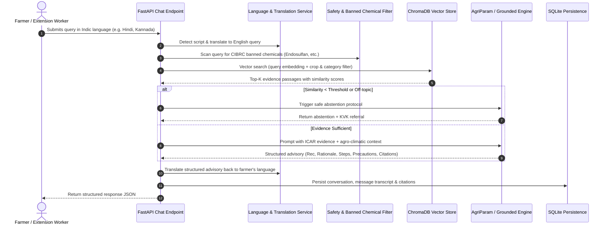

# Agricultural Retrieval-Augmented Generation (RAG) Pipeline

## 1. Overview of the RAG Flow

The RAG pipeline provides an evidence barrier between the farmer's question and the generation engine, preventing agricultural hallucinations (e.g. fabricated fertilizer quantities or hazardous pesticide mixtures).

---

## 2. Ingestion & Preprocessing

- **Source Corpus:** Located in `knowledge_base/documents/`. Contains 20 curated JSON files covering major cereal, pulse, oilseed, cash, and horticultural crops along with soil health and central schemes.
- **Chunking Strategy:** Semantic sentence boundary chunking (`chunk_size = 450 words`, `chunk_overlap = 80 words`). Ensures complete agronomic thoughts and fertilizer split instructions remain intact.
- **Metadata Tagging:**
  - `document_id`: Unique identifier (e.g., `icar_rice_001`).
  - `title`: Official publication name.
  - `source`: Publishing institute (e.g., *ICAR-NRRI Cuttack*).
  - `source_url`: Verifiable government URL.
  - `crop`: Specific crop or `"All Crops"`.
  - `category`: `cultivation`, `irrigation`, `fertilizer_management`, `pest_management`, `soil_health`, `government_schemes`.
  - `region`: Specific agro-climatic zone or `"All-India"`.

---

## 3. Retrieval Optimization & Fallback Projection

1. **Cosine Similarity Space:** ChromaDB initialized with `{"hnsw:space": "cosine"}`.
2. **Deterministic Domain Embeddings:** If SentenceTransformers / PyTorch cannot load, the system utilizes a 384-dimensional domain-boosted projection with CRC32 deterministic hashing and inverse stop-word dampening.
3. **Multi-Tier Filtering:**
   - Tier 1: Query filtered strictly by identified crop or `"All Crops"`.
   - Tier 2: If filtered search returns 0 chunks, executes global vector retrieval across the entire knowledge base to identify cross-crop agronomic principles (e.g. Soil Health Card guidelines applied to Paddy).

